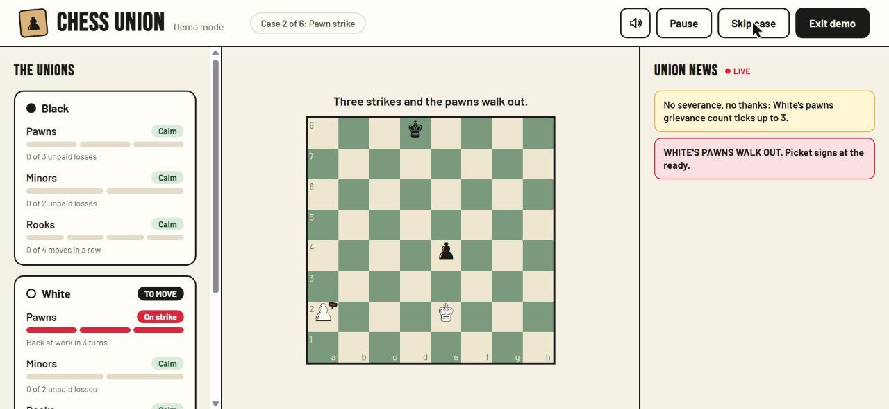

# Chess Union



Chess where the pieces unionize. Lose pieces for nothing and their union
stops cooperating — pawns go on strike, bishops work to rule, rooks take a
nap — until a capture calms things down, the strike runs its course, or the
position itself forces them back to work.

Built solo for the Neura AI Club STEAL//REMAKE 24-hour hackathon.

## What I changed

This is a normal, fully legal game of chess — castling, en passant,
promotion, check, checkmate, stalemate, the fifty-move rule, all of it.
The rules engine is [chess.js](https://github.com/jhlywa/chess.js),
untouched. On top of that, I built:

- **The union rule layer** (`src/lib/unionRules.js`, `src/lib/rulesConfig.js`)
  — a pure, React-free state machine with no dependency on the UI. It
  tracks three "unions" per side (pawns, minors, rooks) and decides, for
  any position, which of chess.js's legal moves are actually allowed.
- **The UI** — a union status panel (meters, status chips), picket signs
  on striking pawns, status-icon overlays on restricted bishops and
  sitting-out rooks, a strike banner, and a blocked-move toast, around a
  board whose pieces are rendered as text glyphs (not images), so there's
  no piece-art licence to worry about.
- **The news system** (`src/lib/headlines.js`) — every union event becomes
  a plain-English headline in a live feed, with several phrasings per
  event type chosen deterministically so a given event doesn't always
  read identically.
- **The bot** (`src/lib/bot.js`) — a legal-moves-only opponent (random or
  greedy-capture) that answers to the exact same union rules a human
  player does.
- **Sound** — every event above has a short sound effect, synthesized in
  the browser with no audio files (see Credits).
- **Demo mode** — a scripted, six-case tour of every union mechanic,
  played on the real engine, not a recording (see below).

Chess itself — the game, its rules, the pieces — is not mine; it's chess.
[Lichess](https://lichess.org) and [Chess.com](https://www.chess.com) were
inspiration for presentation only (a clean desktop board with a side panel
and a live feed); no code, assets, or design files from either were used.

## How the rules work

- **Unpaid loss:** a piece is captured and that side's very next move
  isn't a capture. That's an unpaid loss for the piece's union.
- **Grievance:** each union has a grievance counter. An unpaid loss adds
  one; any capture that side makes lowers every one of its grievance
  counters by one (minimum zero).
- **Pawns — strike:** 3 unpaid pawn losses and the pawns refuse to move or
  capture for 3 of that side's turns. They still block squares and can
  still be captured. Shown with a picket sign and a "PAWNS ON STRIKE"
  banner.
- **Minors — work-to-rule:** bishop and knight losses share one grievance
  counter, but only bishops are ever restricted. At 2 unpaid losses, the
  remaining bishops can move at most 2 squares for 3 turns (if none are
  left, there's nothing to restrict). Shown with the red anger icon and a
  "BISHOPS ON WORK-TO-RULE" banner.
- **Rooks — sit-out:** no grievance involved — the same rook moving 4
  turns in a row puts the rook union to sleep for 1 turn. Shown with the
  blue "zzz" icon and a "ROOKS TAKE A NAP" banner.
- **Cooldown:** after a pawn or minors strike ends, that union can't
  strike again for 5 turns; grievance resets to zero.
- **Strike-break ("the King crosses the picket line"):** if a union's
  restriction would leave that side with no legal move at all — most
  often in check, with only a struck piece able to answer — the strike
  breaks immediately and heads into cooldown. This guarantees chess.js's
  own checkmate/stalemate detection stays correct, since a side always has
  a legal move unless the game is genuinely over.

Thresholds and durations all live in one place:
[`src/lib/rulesConfig.js`](src/lib/rulesConfig.js).

## Demo mode

Click **Watch demo** on the start screen, or open `/?demo=1` directly. It
plays six short, scripted positions back to back on the real engine (not a
recording — every move goes through the same `legalMoves()`/`applyMove()`
functions the live game uses), one per union mechanic: an unpaid loss, a
pawn strike, a capture calming things down, minors work-to-rule, a rook
nap, and a strike-break. About 60–90 seconds total, with Pause/Resume,
Skip case, and Exit controls, and a progress indicator. Each case is
asserted by a Vitest test (`src/lib/demoScript.test.js`), so the sequence
it plays is exactly the sequence that's been verified to produce that
case.

## Running it

```sh
npm install
npm run dev     # starts the dev server (prints the localhost URL)
npm run build   # production build
npm run lint    # oxlint
npm test        # vitest
```

No backend, no database, no paid APIs or AI services — it's a static
front-end app.

## Licences

| What | Licence |
| --- | --- |
| This project's own code | MIT — see [LICENSE](LICENSE) |
| [chess.js](https://github.com/jhlywa/chess.js) | BSD-2-Clause |
| [react-chessboard](https://github.com/Clariity/react-chessboard) | MIT |
| Fonts: Bebas Neue, Barlow, Noto Sans Symbols 2 (Google Fonts) | SIL Open Font License 1.1 |
| `public/icons/anger.png`, `public/icons/zzz.png` | Original artwork for this project |

## Credits

Chess rules and move generation by [chess.js](https://github.com/jhlywa/chess.js) (BSD-2-Clause).
Board rendering by [react-chessboard](https://github.com/Clariity/react-chessboard) (MIT).
Sounds are generated in the browser with the Web Audio API.
